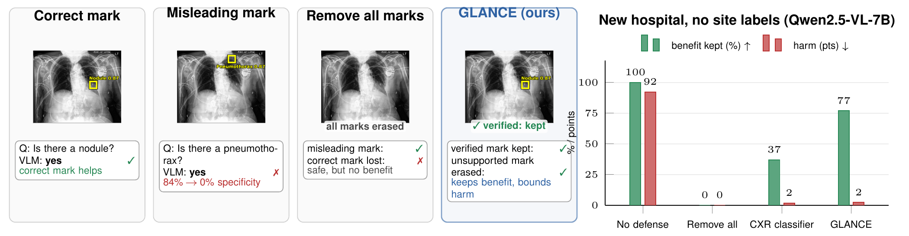
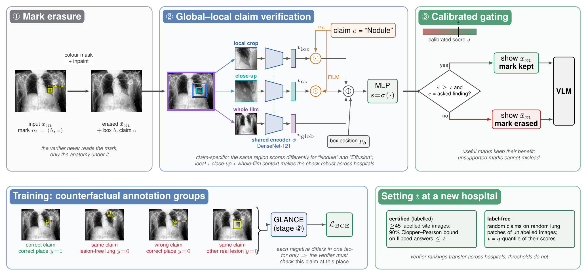
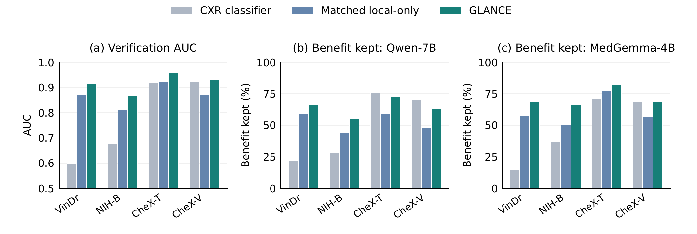

<div align="center">

# GLANCE

### Global–Local Annotation Consistency Estimation for Robust Medical Vision-Language Models

*Keep the marks that are right. Erase the ones that are not.*


[**Project page**](https://airesearchfolio.github.io/glance/) · [**Results**](#results) · [**Method**](#method) · [**Citation**](#citation)



</div>

---

## Overview

Radiographs reach medical vision-language models (VLMs) with CAD boxes, labels and arrows burned into the pixels, and the VLMs simply believe them. A misleading mark on normal lung can drop the specificity of Qwen2.5-VL-7B from **84% to 0%**, while removing every mark throws away the benefit of the correct ones.

**GLANCE** is a claim-conditioned verifier placed in front of the VLM. For every mark it:

1. **Erases** the mark (colour mask + inpainting), so the verifier reads anatomy only and never the label it is judging.
2. **Verifies** the claimed finding at the marked location from a local crop, a lesion close-up and the whole radiograph.
3. **Gates** the mark with a calibrated site threshold, so the VLM sees the marked image only if the claim is supported.

Counterfactual training teaches the verifier to check *this claim at this place*, not to detect any abnormality. At a new hospital the threshold is set either with a **certified** finite-sample bound from 45 labelled images or **label-free** from unlabelled images.

> **Scope of the certificate.** It bounds answer flips relative to the clean-image answer under our sampled marks and i.i.d. site images. It does not certify diagnostic error, realistic-CAD or extraction failures, or the label-free rule.

## Highlights

| | |
|---|---|
| **Up to 95 points** | accuracy lost to a misleading mark across six VLMs |
| **0.959 AUC** | verification of correct vs. misleading marks, CheXlocalize-Test |
| **77% benefit kept** | at 2.3 points of harm, no site labels (Qwen2.5-VL-7B), vs. 37% for a chest X-ray classifier |
| **45 images** | enough for the certified threshold |
| **739 / 744** | box marks recovered from pixels alone (arrows: 686 / 744) |

## Method



| Step | What happens |
|---|---|
| **1. Mark erasure** | Overlay pixels are found from the RGB channel spread (τ = 12, 3×3 dilation twice) and removed by Telea inpainting. |
| **2. Global–local verification** | Local crop, close-up and whole film pass through one shared DenseNet-121 (torchxrayvision init). The claim embedding modulates the lesion views by FiLM; an MLP over all features, the claim and the box position outputs a support score. |
| **3. Counterfactual training** | Each radiologist box yields a group: correct claim, same claim on lesion-free lung, other claim on the true box, same claim on another real lesion. Each negative differs in exactly one factor. |
| **4. Calibrated gating** | Per-finding Platt scaling, then `D_t(x_m) = x_m` if `s̃ ≥ t` and the claim matches the question, else the erased image. |

**Verification is easier than detection.** One trained network reaches AUC 0.921 when verifying a claim at the marked location and 0.635 when searching the lung for the same finding.

### Setting the threshold at a new hospital

| Rule | Needs | Guarantee |
|---|---|---|
| **Certified** | ≥ 45 labelled images | Exact Clopper–Pearson bound with fixed-sequence testing: with probability ≥ 1−δ every accepted threshold keeps both flip rates ≤ k (δ = 0.1, k = 5%) under i.i.d. site images |
| **Label-free** | unlabelled images | None; the q-quantile (q = 0.95) of scores of synthetic wrong marks, validated empirically |

## Benchmark

Marks are derived from radiologist annotations, in three visual styles (arrow with label, CAD-style box with label and score, label only). For each image we ask about a present finding and an absent finding, with correct, misleading (lesion-free lung) and irrelevant marks.

| Evaluation set | Images | Role |
|---|---|---|
| VinDr-CXR | 285 | development |
| NIH ChestX-ray14 (NIH-B) | 309 | development |
| CheXlocalize-Test | 248 | pre-registered; informed model selection |
| CheXlocalize-Val | 110 | untouched, evaluated once |

VLMs: Qwen2.5-VL-7B / 32B, InternVL3-8B, MedGemma-4B / 27B, Lingshu-7B, served with vLLM at temperature 0.

Metrics: verification AUC (correct vs. misleading mark); **benefit** and **harm** in accuracy points; **benefit kept** under a harm budget of 5 points, with the threshold chosen on half of the patients and measured on the other half over 200 splits.

## Results



**Benefit kept (%) at harm ≤ 5, CheXlocalize-Test / Val**

| Defense | AUC (Test) | Qwen-7B | Qwen-32B | InternVL3 | MedGemma-4B | Lingshu |
|---|---|---|---|---|---|---|
| VLM self-check | 0.779 | 17 / 10 | 23 / 14 | 21 / 8 | 8 / 1 | 42 / 34 |
| Detect-then-check | 0.825 | 34 / 32 | 47 / 46 | 52 / 23 | 40 / 42 | 53 / 37 |
| CXR classifier on region | 0.919 | **76 / 70** | 76 / **70** | 63 / 52 | 71 / 69 | 67 / 79 |
| Matched local-only | 0.923 | 59 / 48 | 56 / 39 | 57 / 48 | 77 / 57 | 59 / 69 |
| **GLANCE (final)** | **0.959** | 73 / 63 | 73 / 57 | 69 / 65 | 82 / **69** | 82 / **88** |

**Across sites (AUC, GLANCE vs. CXR classifier):** VinDr-CXR 0.914 vs. 0.599 · NIH-B 0.867 vs. 0.676 · CheXlocalize-Test 0.959 vs. 0.919 · CheXlocalize-Val 0.931 vs. 0.923. On VinDr-CXR and NIH-B, GLANCE retains 27–54 more points of benefit in every one of the 200 splits.

**New hospital, CheXlocalize-Test, Qwen2.5-VL-7B / MedGemma-4B (kept % / harm points)**

| Operating point | CXR classifier | GLANCE |
|---|---|---|
| Fixed threshold 0.5 | 99 / 100 · harm 87 / 41 | 35 / 62 · harm 0 / 0 |
| Label-free, per-claim | 37 / 22 · harm 1.8 / 0.1 | **77 / 66** · harm 2.3 / 0.0 |
| Certified, 45 images | 51 / 51 · harm 2.1 / 1.9 | 51 / **78** · harm 1.9 / 2.0 |

**End to end (erase → score → re-query):** GLANCE retains 63–70% of the benefit for Qwen2.5-VL-7B and 64–80% for MedGemma-4B on the two held-out splits, with 1–2 points of harm under the certified threshold.

**Pixel-only evaluation (CheXlocalize-Test, mean benefit / harm in points):**

| Mark style | Pixel-extracted | Oracle (b, c) |
|---|---|---|
| Box with label and score | 24.37 / 0.27 | 24.69 / 0.22 |
| Arrow with label | 18.68 / 0.85 | 24.64 / −0.04 |

Pooled descriptive means without patient-level confidence intervals; arrow extraction reduces benefit.

## Ablations

| Variant | CheXloc.-Test AUC | Qwen / MedG kept | NIH-B AUC | Qwen / MedG kept |
|---|---|---|---|---|
| **GLANCE final** | .959 | 73 / 82 | .867 | 55 / 66 |
| − close-up, whole film | .923 | 59 / 77 | .811 | 44 / 50 |
| − box position | .955 | 73 / 81 | .863 | 54 / 58 |
| − FiLM | .956 | 78 / 80 | .908 | 61 / 69 |
| + mirror view, ranking loss | .956 | 74 / 86 | .874 | 58 / 66 |

The global–local views carry the method. FiLM adds no consistent gain and is kept for fidelity to the pre-registered design.

## Pixel-only mark extraction

To test operation without renderer metadata, box and arrow geometry and label claims are recovered from the marked image alone: colour mask and connected components with line structure for boxes, a Hough shaft plus distance-transform head for arrows, Qwen2.5-VL-7B text recognition for labels, and alias / fuzzy mapping to the finding vocabulary. Unrecognised or missing marks are rejected rather than assigned an oracle claim. On single-mark CheXlocalize-Test, extraction jointly recovered usable geometry and claim for 739/744 box marks (99.3%) and 686/744 arrow marks (92.2%).

## Limitations

- Marks are rendered from radiologist annotations, and harmful marks are sampled (lesion-free lung, wrong label, other lesion). Harm control may not transfer to realistic CAD false positives. GLANCE is evaluated as verification of an extracted mark and claim, not as an end-to-end CAD defense.
- Frontal chest radiographs, yes/no questions and single rendered marks only. Multiple or overlapping marks, grayscale overlays, free-form text, unlabelled arrows, other modalities and open-ended responses are untested, as is a placebo-erasure control for inpainting shortcuts.
- NIH ChestX-ray14 boxes come from a single reader; CheXlocalize has few Nodule/Mass and Pneumothorax cases.
- GLANCE and the classifier baseline share torchxrayvision weights pretrained with image-level labels that include NIH ChestX-ray14 and CheXpert.
- CheXlocalize-Test informed model selection; only CheXlocalize-Val was untouched.

## Data and models

All data are public and de-identified. Obtain them from their original sources and follow their licences:

| Resource | Used for |
|---|---|
| [VinDr-CXR](https://physionet.org/content/vindr-cxr/) | training and evaluation (boxes from ≥ 2 of 3 radiologists) |
| [NIH ChestX-ray14](https://nihcc.app.box.com/v/ChestXray-NIHCC) | training and evaluation (single-reader boxes) |
| [CheXlocalize](https://stanfordaimi.azurewebsites.net/datasets/abfb5ea3-6e57-4b8a-bb5a-1e8f2b3b3a3c) | held-out evaluation (radiologist outlines on CheXpert studies) |
| [torchxrayvision](https://github.com/mlmed/torchxrayvision) | DenseNet-121 initialisation; classifier baseline |
| Qwen2.5-VL, InternVL3, MedGemma, Lingshu | VLMs under test (served with [vLLM](https://github.com/vllm-project/vllm)) |

## Code

Code, checkpoints and evaluation scripts will be released with the camera-ready version. During review, this repository hosts the project page only.

## Citation

Anonymous during review; this entry will be updated after the decision.

```bibtex
@inproceedings{glance2027,
  title     = {{GLANCE}: Global--Local Annotation Consistency Estimation
               for Robust Medical Vision-Language Models},
  author    = {Anonymous},
  booktitle = {Under review at the IEEE/CVF Conference on Computer Vision
               and Pattern Recognition (CVPR)},
  year      = {2027}
}
```

## Acknowledgements

We thank the creators of VinDr-CXR, NIH ChestX-ray14, CheXpert / CheXlocalize and torchxrayvision, and the teams behind Qwen2.5-VL, InternVL3, MedGemma, Lingshu and vLLM.
